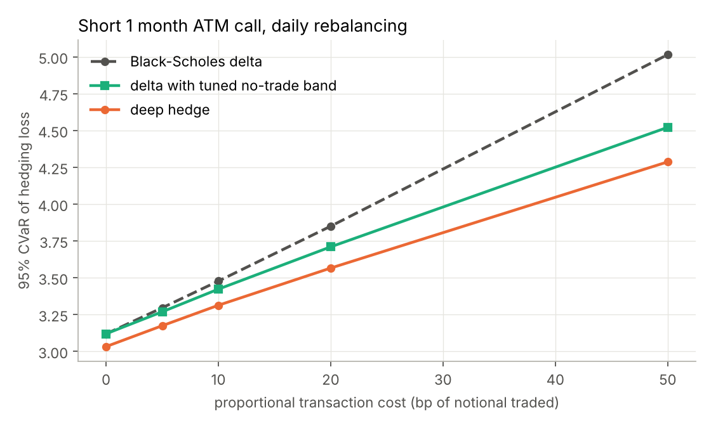
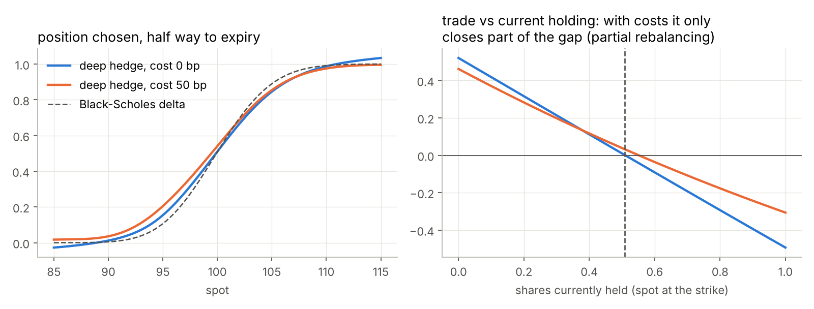
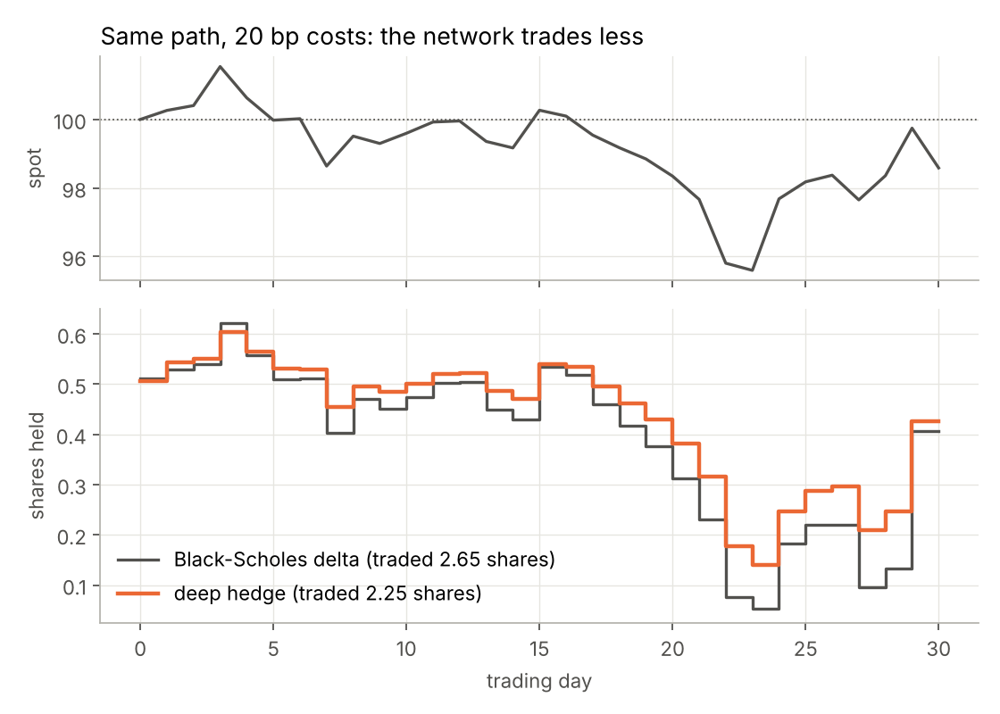

# Deep hedging with PyTorch

[](https://github.com/adrienliao/deep-hedging/actions/workflows/tests.yml)


Black-Scholes tells you to hedge an option with delta, rebalanced continuously and for free. In practice you rebalance once a day and every trade costs money, so delta hedging is no longer optimal. This project follows Buehler, Gonon, Teichmann and Wood (2019): instead of deriving a hedging rule, a neural network is trained to choose the hedge directly, by minimising the tail risk of the final P&L over simulated paths.

## Setup

* Short one ATM call, 1 month to expiry, 20% vol, hedged daily with the underlying (30 rebalancing dates)
* Proportional transaction costs from 0 to 50 bp of the notional traded, including opening and closing the hedge
* Objective: the 95% CVaR (expected shortfall) of the hedging loss, minimised through the Rockafellar-Uryasev formulation so that the VaR threshold is learned jointly with the network
* Policy: one MLP shared across dates. Inputs are normalised log moneyness, time to expiry, and **the position already held**, which is what lets it learn that trading has a cost
* Training on fresh simulated paths at every step (1500 steps of 4096 paths), evaluation on 200,000 separate test paths

Baselines are no hedge, Black-Scholes delta, and delta with a no-trade band whose width is tuned on separate validation paths for each cost level, so the comparison is fair.

## Results



95% CVaR of the hedging loss (lower is better; the Black-Scholes premium is 2.29):

| Cost | No hedge | BS delta | Tuned band | Deep hedge | Gain vs BS delta |
| --- | --- | --- | --- | --- | --- |
| 0 bp | 12.42 | 3.12 | 3.12 | **3.03** | 3% |
| 5 bp | 12.42 | 3.30 | 3.27 | **3.17** | 4% |
| 10 bp | 12.42 | 3.48 | 3.42 | **3.31** | 5% |
| 20 bp | 12.42 | 3.85 | 3.71 | **3.57** | 7% |
| 50 bp | 12.42 | 5.02 | 4.52 | **4.29** | 15% |

What I find interesting:

* **Without costs the network rediscovers Black-Scholes delta** from nothing but simulated prices and a loss function (left panel below). It sits slightly away from delta because it optimises tail risk with daily rebalancing, not variance in continuous time, which is also why it still beats delta by 3% at zero cost.
* **With costs it learns partial rebalancing.** Plotting the trade it makes against the position it already holds, the slope goes from about -1 (move fully to target) to about -0.75: it only closes part of the gap each day.
* **It beats the tuned band while trading slightly more** (1.05 shares per path against 0.96 at 50 bp). The gain comes from choosing *when* to trade depending on spot and time to expiry, which a fixed band cannot do.





## Code

| File | Content |
| --- | --- |
| `deephedge/market.py` | Exact GBM simulation and Black-Scholes price and delta, in torch |
| `deephedge/pnl.py` | P&L of the hedged short call with proportional costs |
| `deephedge/risk.py` | Empirical CVaR and the differentiable Rockafellar-Uryasev objective |
| `deephedge/strategies.py` | No hedge, delta, banded delta, and the `DeepHedger` network |
| `deephedge/train.py` | Training loop (Adam, cosine schedule, VaR threshold initialised at the empirical quantile) |
| `scripts/run_experiments.py` | Trains one model per cost level, writes `results/` and the figures |

Trained weights and all numbers are in `results/`, so the figures can be redrawn without retraining.

## Tests

* P&L accounting checked on a hand computed path, including costs
* the simulator is a martingale, BS price matches a known value, BS delta equals the autograd derivative of the price
* delta hedging with 365 steps replicates the premium
* the Rockafellar-Uryasev objective equals the empirical CVaR at its optimum, and CVaR of a standard normal is 2.063
* a short training run more than halves the risk of not hedging

## Run it

```bash
pip install torch --index-url https://download.pytorch.org/whl/cpu
pip install -e ".[dev]"
pytest -q
python scripts/run_experiments.py                  # about 10 minutes on a laptop CPU
python scripts/run_experiments.py --figures-only   # redraw from the saved models
```

## Next steps

Heston dynamics (where Black-Scholes delta is misspecified and the network should gain much more), hedging with a second option to handle vega, and a recurrent policy to compare against the feedforward one.

## References

* H. Buehler, L. Gonon, J. Teichmann, B. Wood (2019), *Deep hedging*, Quantitative Finance
* R. T. Rockafellar, S. Uryasev (2000), *Optimization of conditional value at risk*
* A. Whalley, P. Wilmott (1997), *An asymptotic analysis of an optimal hedging model for option pricing with transaction costs*
